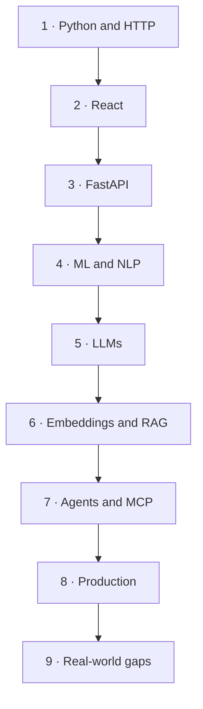
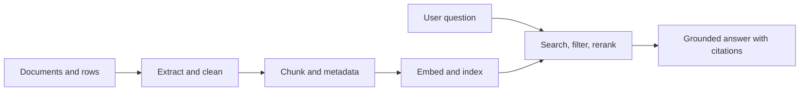
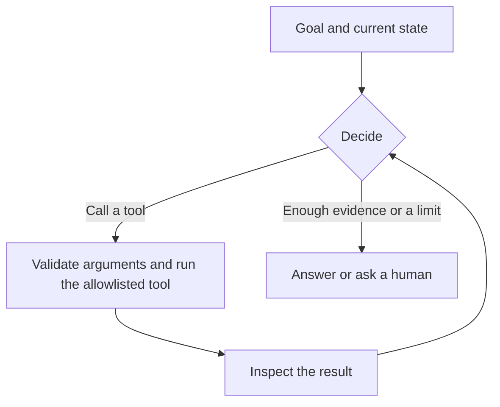
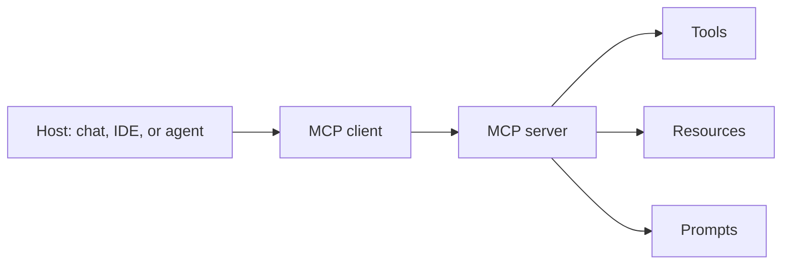

<div align="center">

# Complete GenAI Engineer Preparation Roadmap

A full-stack path from Python and React to LLMs, RAG, agents, MCP, and production systems.

Prepare for real projects and technical interviews. Terminology alone is not the goal.

| | | | |
| :---: | :---: | :---: | :---: |
| **12 weeks** | **9 phases** | **72 topics** | **5 projects** |
| 1.5–2 hours a day | follow this order | tick when you can use it | one portfolio app |

</div>

> **Outcome.** One polished React + Python application with RAG, a tool-using agent, an MCP integration, a local deployment option, automated tests, and a written architecture.

---

## On this page

| Foundations | Build | Prove |
| --- | --- | --- |
| [How to use this roadmap](#1-how-to-use-this-roadmap) | [Python backend](#5-python-backend) | [Projects](#18-projects) |
| [Terms that get mixed up](#2-terms-that-get-mixed-up) | [React.js frontend](#6-reactjs-frontend) | [12-week plan](#19-12-week-plan) |
| [Technology stack](#3-technology-stack) | [LLM landscape](#7-llm-landscape) | [Interview checklist](#20-interview-checklist) |
| [Learning checklist](#4-learning-checklist) | [Prompt and context engineering](#8-prompt-engineering-and-context-engineering) | [System design drills](#21-system-design-drills) |
| | [Embeddings and vector search](#9-embeddings-and-vector-search) | [Common failure modes](#22-common-failure-modes) |
| | [RAG](#10-rag) | [Priority order](#23-priority-order) |
| | [Structured data and text-to-SQL](#11-structured-data-and-text-to-sql) | [Short resource list](#24-short-resource-list) |
| | [AI agents and workflows](#12-ai-agents-and-workflows) | |
| | [MCP](#13-mcp) | |
| | [Databases and storage](#14-databases-and-storage) | |
| | [APIs, local models, and cloud](#15-apis-local-models-and-cloud-platforms) | |
| | [Infrastructure and deployment](#16-infrastructure-and-deployment) | |
| | [Junior to strong](#17-skills-that-separate-junior-from-strong) | |

---

## 1. How to use this roadmap

Follow the phase order. Build a small project beside each phase. Agents and multi-framework RAG come after you can call a model, embed text, and serve a normal API.

| Rule | What to do |
| --- | --- |
| Sequence matters | Python, HTTP, React, and FastAPI come before agents. |
| Build while learning | Ship a tiny working app with every phase. |
| Concepts before frameworks | Implement one workflow in plain Python, then repeat it in one framework. |
| One framework at a time | Start with LangGraph. Add another framework when a project needs it. |
| Verify vendor limits | Free tiers, model IDs, and prices change. Check them the week you use them. |
| Tick the boxes | Check a topic when you can explain it and use it. |



---

## 2. Terms that get mixed up

These are separate objects. Use the right name in design reviews and interviews.

| Term | What it is |
| --- | --- |
| Model weights / checkpoint | The trained parameters you load or download. |
| Inference server | A process that runs those weights and exposes an API. Examples: Ollama, vLLM, llama.cpp. |
| Model API | A hosted endpoint that generates text, embeddings, or images. |
| AI gateway | One interface in front of many providers, with routing, fallbacks, and spend logs. LiteLLM is the usual start. |
| Orchestration framework | Application code that chains prompts, tools, and state. Examples: LangGraph, LlamaIndex. |
| LLM | A model that generates or reasons over text and other supported inputs. |
| Embedding model | A model that turns inputs into vectors for similarity search. |
| RAG | Retrieval of external knowledge at inference time, then a grounded answer. |
| Fine-tuning | Further training that changes model behavior or parameters. |
| Workflow | A path you defined in advance: steps, branches, and stops. |
| Agent | A loop that chooses tools, inspects results, and continues toward a goal inside limits you set. |
| MCP | A protocol for connecting an application to tools and data. The model still needs application logic. |

---

## 3. Technology stack

| Layer | What belongs here |
| --- | --- |
| AI and LLM engineering | LLMs, transformers, prompting, context management, tokenization, embeddings, vector search, RAG, agents, MCP, evaluation, fine-tuning, guardrails |
| Backend — Python | Python, OOP, FastAPI, REST, async, authentication, background jobs, testing, WebSockets, streaming |
| Frontend — React.js | JavaScript, TypeScript, hooks, components, API integration, chat UI, streaming, state, authentication |
| Data and storage | PostgreSQL, Redis, DynamoDB, vector databases, ingestion, object storage, metadata, caching |
| Infrastructure | Linux, Git, Docker, Docker Compose, Nginx, CI/CD, local LLM serving, cloud, secrets, monitoring, scale |

### What a portfolio should show

| Layer | Evidence in the project |
| --- | --- |
| Product | Chat UI, citations, upload, permissions, stop and retry |
| Intelligence | Grounded answers, tool use, an MCP integration |
| Reliability | Tests, evals, retries, idempotent jobs, traces |
| Operations | Docker Compose, CI, secrets outside the repo, a setup guide |

---

## 4. Learning checklist

Nine phases, eight topics each. The order is a suggestion. You can build small apps before every mathematical detail feels finished.

| Phase | Focus | Time | Done when |
| :---: | --- | --- | --- |
| 1 | Programming foundations | 1–2 weeks | A typed Python program calls an HTTP API, handles errors, and is in Git. |
| 2 | Frontend foundations | 1–2 weeks | A React + TypeScript page loads data and handles loading, empty, and error. |
| 3 | Backend engineering | 1–2 weeks | An authenticated FastAPI service has SQL migrations and tests. |
| 4 | Machine learning and NLP | 1–2 weeks | You can explain a transformer block and compute cosine similarity on a tiny vector. |
| 5 | LLM foundations | 1 week | You can call a chat model and an embedding model and return schema-valid JSON. |
| 6 | Embeddings and RAG | 1–2 weeks | An upload can be questioned, cited, or refused when evidence is weak. |
| 7 | Agents and MCP | 1–2 weeks | An agent calls two tools, stops on a budget, and asks before a write. |
| 8 | Production GenAI | 1–2 weeks | Docker Compose runs the app, retries stay single, and a trace shows token cost. |
| 9 | Real-world gaps | 1–2 weeks | You can defend cache, validation, data access, and how a bad prompt is caught. |

### Phase 1 — Programming foundations

`1–2 weeks` · `8 topics`

> **Done when.** You can write a small typed Python program that calls an HTTP API, handles errors, and is committed with Git.

- [ ] Python syntax, collections, and control flow
- [ ] Functions, modules, exceptions, and file handling
- [ ] OOP, decorators, generators, and context managers
- [ ] Type hints, dataclasses, and Pydantic
- [ ] Iterators, comprehensions, and dependency management
- [ ] Async/await, asyncio, threads, and processes
- [ ] Git, GitHub, terminal, and Linux basics
- [ ] HTTP, JSON, DNS, TCP/IP, and client-server architecture

### Phase 2 — Frontend foundations

`1–2 weeks` · `8 topics`

> **Done when.** A React + TypeScript page loads remote data and handles loading, empty, and error states.

- [ ] HTML5, CSS, responsive design, and Flexbox/Grid
- [ ] JavaScript ES6+, promises, and async/await
- [ ] TypeScript fundamentals and interfaces
- [ ] React components, props, and JSX
- [ ] State, events, `useState`, `useEffect`, and `useRef`
- [ ] Custom hooks, context, and component composition
- [ ] Forms, validation, and API calls
- [ ] Routing, error states, loading states, and accessibility

### Phase 3 — Backend engineering

`1–2 weeks` · `8 topics`

> **Done when.** You can ship an authenticated FastAPI service with SQL migrations and tests.

- [ ] FastAPI routes, request and response models, and Pydantic
- [ ] REST conventions, status codes, and API versioning
- [ ] Dependency injection and middleware
- [ ] Async endpoints and external API calls
- [ ] Authentication, authorization, JWT, OAuth2, and RBAC
- [ ] SQL, ORM, migrations, transactions, and indexes
- [ ] File uploads, pagination, filtering, and validation
- [ ] Pytest, mocking, integration tests, and API documentation

### Phase 4 — Machine learning and NLP

`1–2 weeks` · `8 topics`

> **Done when.** You can explain a transformer at the block level and compute cosine similarity by hand on a tiny vector.

- [ ] Supervised, unsupervised, and self-supervised learning
- [ ] Train, validation, and test splits; overfitting and leakage
- [ ] Vectors, matrices, dot product, cosine similarity, and norms
- [ ] Probability, distributions, and basic statistics
- [ ] Neural networks, loss functions, gradient descent, and backpropagation
- [ ] NLP, tokenization, vocabulary, and subword tokens
- [ ] Transformers, attention, self-attention, and positional encoding
- [ ] Encoder, decoder, encoder-decoder, and inference

### Phase 5 — LLM foundations

`1 week` · `8 topics`

> **Done when.** You can call a chat model and an embedding model, count tokens, and return a schema-valid JSON object.

- [ ] LLM architecture and model families
- [ ] Pretraining, instruction tuning, SFT, and RLHF/DPO concepts
- [ ] System, developer, and user instructions; prompt structure
- [ ] Context windows, tokens, latency, throughput, and cost
- [ ] Temperature, top-p, max output tokens, and stop sequences
- [ ] Structured outputs, JSON schemas, and tool/function calling
- [ ] Hallucinations, grounding, and model limitations
- [ ] Model selection: quality, context, cost, latency, and licensing

### Phase 6 — Embeddings and RAG

`1–2 weeks` · `8 topics`

> **Done when.** A user can upload a document and receive an answer with a citation, or a refusal when the evidence is weak.

- [ ] Embedding models and vector representations
- [ ] Chunking by size, overlap, structure, and semantics
- [ ] Document parsing, cleaning, and metadata extraction
- [ ] Vector databases, indexes, distance metrics, and filtering
- [ ] Dense retrieval, BM25, and hybrid search
- [ ] Top-k retrieval, reranking, and contextual compression
- [ ] RAG pipelines, citations, and source attribution
- [ ] Retrieval evaluation, answer evaluation, and failure analysis

### Phase 7 — Agents and MCP

`1–2 weeks` · `8 topics`

> **Done when.** An agent can call two tools, stop on a step budget, and ask a human before a write.

- [ ] Tool calling and typed tool schemas
- [ ] Agent loop: plan, act, observe, and stop
- [ ] Workflows and autonomous agents, and when each fits
- [ ] State, memory, checkpoints, and conversation history
- [ ] Single-agent and multi-agent architecture trade-offs
- [ ] MCP hosts, clients, servers, and protocol concepts
- [ ] MCP tools, resources, prompts, and transports
- [ ] Approvals, permissions, timeouts, retries, and agent safety

### Phase 8 — Production GenAI

`1–2 weeks` · `8 topics`

> **Done when.** The same app runs from Docker Compose, a retry does not duplicate work, and a trace shows token cost.

- [ ] Redis caching and request deduplication
- [ ] Queues, workers, retries, and idempotency
- [ ] LLM observability, tracing, and token-cost tracking
- [ ] RAG and agent evaluation datasets and regression tests
- [ ] Prompt injection and indirect prompt injection
- [ ] PII handling, access control, and tenant isolation
- [ ] Rate limits, circuit breakers, and fallback models
- [ ] Docker, CI/CD, deployment, monitoring, and incident response

### Phase 9 — Gaps that show up on the job

`1–2 weeks` · `8 topics`

> **Done when.** You can defend the capstone: what is cached, what is validated, which data the model may see, and how a bad prompt change is caught.

- [ ] Prompt patterns, prompt versioning, and eval-gated prompt changes
- [ ] Context budgets, history summarization, and provider prompt caching
- [ ] Guardrails, schema validation, and safe rendering of model output
- [ ] Exact cache, semantic cache, and batch inference
- [ ] Text-to-SQL with a read-only database role and query limits
- [ ] Provider abstraction, AI gateways, and one cloud model platform
- [ ] Evaluation frameworks and tests that tolerate non-determinism
- [ ] Data residency, retention, deletion, and a small red-team checklist

---

## 5. Python backend

> Design and build APIs well enough that generated code is a draft, not the design.

| Main topic | Subtopics to master |
| --- | --- |
| Python core | Collections, functions, scope, exceptions, comprehensions, modules |
| Advanced Python | Decorators, generators, iterators, context managers, typing, dataclasses |
| Async programming | Coroutines, asyncio, await, gather, semaphores, cancellation, timeouts |
| FastAPI | Routers, Pydantic, dependency injection, middleware, lifespan, OpenAPI |
| API engineering | REST, HTTP methods, status codes, pagination, filtering, idempotency |
| Security | OAuth2, JWT, password hashing, RBAC, CORS, API keys, secret management |
| Database | SQL, joins, transactions, indexes, connection pooling, migrations |
| Background processing | Task queues, workers, retries, scheduled jobs, dead-letter queues |
| Testing | Pytest, fixtures, mocks, async tests, integration and contract tests |
| Performance | Profiling, caching, concurrency limits, connection reuse, rate limiting |
| Production | Structured logging, exception handling, health checks, metrics, tracing |
| LLM integration | Timeouts, streaming, token counts, structured output, provider retries |

| Library | Role |
| --- | --- |
| FastAPI, Pydantic | API, validation, settings |
| SQLAlchemy, Alembic | Models and migrations |
| httpx | Outbound HTTP, including model APIs |
| pytest | Unit, async, and integration tests |
| boto3 | AWS APIs when you deploy there |
| Redis client, PostgreSQL driver | Cache, locks, and the system of record |
| `tiktoken` or the provider counter | Token counts before the call |
| ARQ, Celery, or a cloud queue | Background ingestion and eval jobs |

### Problems worth building

| Problem | What it trains |
| --- | --- |
| Duplicate sync jobs from many users | Locks and idempotency |
| Thousands of paginated records | Streaming and bounded memory |
| Timeouts, retries, rate limits, partial failure | Remote-call discipline |
| Streaming tokens to React, and cancel on Stop | End-to-end streaming |
| Long document ingestion | Queues and job state |
| Conversation history that grows every turn | Context budgets |
| A retried ingest that must stay single | Content hash and idempotency key |
| Messy model JSON | Schema validation and one repair attempt |

### LLM call reliability

Treat every model call as a remote dependency that can be slow, partial, or rate-limited.

| Concern | Practice |
| --- | --- |
| Timeouts | Separate connect, first-token, and total deadlines. |
| Retries | Retry transient failures only. Use exponential backoff with jitter. |
| Idempotency | A client retry must not start a second ingestion or a second side effect. |
| Streaming | Persist partial output. Fail or resume cleanly if the socket drops. |
| Cost | Count prompt and completion tokens. Cap agent loops per user and per job. |
| Schema | Validate output in your code. Repair once, or fail, when validation fails. |

---

## 6. React.js frontend

> Suggested stack: React, TypeScript, Vite, React Router, TanStack Query, Tailwind CSS. Add a state library when the app needs one.

| Main topic | Subtopics to master |
| --- | --- |
| JavaScript | ES6+, destructuring, modules, promises, async/await, closures |
| TypeScript | Types, interfaces, unions, generics, type narrowing |
| React fundamentals | Components, JSX, props, state, events, rendering |
| Hooks | `useState`, `useEffect`, `useRef`, `useMemo`, `useCallback`, custom hooks |
| State management | Context, reducers, Zustand or Redux Toolkit when the app needs them |
| API integration | Fetch or Axios, cancellation, errors, loading states |
| Forms | Controlled inputs, validation, file uploads, multi-step forms |
| Routing | React Router, protected routes, query parameters |
| Styling | CSS, Flexbox, Grid, responsive design, Tailwind CSS |
| Authentication | Login, token or session management, logout, permissions |
| Testing | Vitest or Jest, React Testing Library, Playwright |
| Performance | Lazy loading, code splitting, memoization, virtualization |
| Accessibility | Keyboard navigation, labels, focus management, ARIA |

### GenAI interface skills

| Skill | Include it because |
| --- | --- |
| Chat transcript with roles | The product is a conversation, not a form |
| SSE or WebSocket streaming | Users should see tokens as they arrive |
| Stop and retry | `AbortController` on the client, cancel on the server |
| Markdown, code, tables | Model answers are structured text |
| Sanitized HTML | Model output is untrusted and can carry XSS |
| Clickable citations | Answers need a path back to the source |
| Upload, status, delete | Ingestion is part of the product |
| Tool and agent status | Long runs need visible progress |
| Approval UI | Sensitive actions wait for a person |
| Tokens, latency, feedback | Cost and quality stay visible |
| Reconnect and de-duplication | Refresh and double-submit will happen |

### How to stream

| Need | Use |
| --- | --- |
| One-way token stream | Server-Sent Events |
| Bidirectional traffic, such as live voice | WebSockets |
| A finished JSON answer | Ordinary HTTP |
| The user hits Stop | Abort the browser request and cancel the model call |

Render markdown with a library such as `react-markdown`, and sanitize it.

---

## 7. LLM landscape

> The model, the API provider, the inference server, and the orchestration framework are four different things.

### Architecture

- Transformers and attention
- Encoder-only, decoder-only, and encoder-decoder models
- Dense models and mixture-of-experts (MoE)
- Context length and positional encoding
- Pretraining and instruction tuning
- Quantization and inference

### Tokenization and generation

- BPE, WordPiece, and SentencePiece
- Token IDs, embeddings, and output logits
- Sampling, temperature, and top-p
- Context-window limits
- Prompt tokens and generated tokens
- Time to first token and tokens per second
- Counting tokens before the call, so you can trim context and estimate cost

### Choosing a model

| Kind | Choose it for |
| --- | --- |
| General-purpose chat | Q&A, drafting, summarization |
| Reasoning-oriented | Multi-step work where latency and cost are acceptable |
| Coding | Repository tasks, SQL, refactors |
| Vision-language | Images, screenshots, document pages |
| Small language models | Local demos, classification, routing |
| Open-weight | Control, privacy, and a license you can run yourself |
| Proprietary API | Quality, tools, and a vendor-operated endpoint |

Also weigh context length, license, latency, cost, and quality. A leaderboard rank is one input, not a design.

### Families worth recognizing

| Family | Study it for |
| --- | --- |
| OpenAI GPT | General and reasoning models, structured outputs, tools |
| Google Gemini | Multimodal models and long context |
| Anthropic Claude | General use, coding, and tool workflows |
| Meta Llama | A major open-weight family |
| Qwen | Language, coding, and multimodal families |
| Mistral | General-purpose and smaller deployable models |
| DeepSeek | Reasoning and coding-oriented families |
| Gemma | Open-weight models from Google |
| Whisper | Speech recognition |

### Generation controls

| Control | Be able to explain |
| --- | --- |
| Temperature | How sharply the model prefers high-probability tokens |
| Top-p | The probability mass the sampler may draw from |
| Max output tokens | A hard cap on length and cost |
| Stop sequences | Strings that end generation |
| Seed | An attempt at repeatability. Pair it with an eval set. |
| JSON schema | A constrained shape your code can validate |

Tool calling lets the model request an action. Structured output lets your application parse an answer. Many products need both.

---

## 8. Prompt engineering and context engineering

| | Prompt engineering | Context engineering |
| --- | --- | --- |
| Question | How should the instruction be written? | What is allowed into the window? |
| Examples | Wording, examples, schema, delimiters | History, tools, retrieved passages, user data |
| Failure | The model does the wrong task | The model never sees the right evidence, or the bill explodes |

### Prompt patterns

- A clear task, constraints, and an output shape
- Zero-shot and few-shot examples
- Delimiters between instructions and untrusted data
- Chain-of-thought when intermediate reasoning helps
- ReAct-style traces when the model interleaves reasoning and tools
- Splitting a large task into smaller calls
- Versioned templates with variables
- A change process: edit, run the eval set, then ship

> **Prompt caching.** Keep stable instructions at the start of the prompt when the provider supports caching. Put the user text and retrieved chunks after that prefix.

### Context budget

| Slot | Typical contents | If you skip the design |
| --- | --- | --- |
| Stable prefix | System instructions, tool schemas | Cache misses and drifting behavior |
| History | Recent turns, plus a summary of older ones | Repeated tokens, or a forgotten task |
| Retrieved evidence | Top passages with source IDs | Answers that ignore the documents you fetched |
| User turn | The current question and attachments | Instructions buried under a long paste |
| Reserved output | Room left for the completion | Truncated JSON and broken tool calls |

Also learn sliding-window history, conversation summaries, tool-result trimming, and the “lost in the middle” effect: long contexts are used more reliably at the start and the end.

### Guardrails

A sentence in the system prompt is an instruction. Enforcement lives in your code.

| Step | Control |
| :---: | --- |
| 1 | Validate structure with a schema. |
| 2 | Allowlist tools and check arguments in your code. |
| 3 | Redact inputs and outputs you are not allowed to send or show. |
| 4 | Abstain when retrieval evidence is missing. |
| 5 | Log the decision, including a blocked answer. |

After those five work, you can explore provider guardrails, Llama Guard, NeMo Guardrails, and Guardrails AI.

---

## 9. Embeddings and vector search

An embedding model turns text, images, or other supported inputs into vectors. Similar meaning lands nearby in that space.

| Step | Example |
| --- | --- |
| Query | “How do I reset my password?” |
| Embed | A vector such as `0.12, -0.08, …` |
| Search | “Account password recovery instructions.” |

### Topics

| Area | Cover |
| --- | --- |
| Vectors | Dimensions, normalization, cosine, dot product, Euclidean distance |
| Compatibility | The same model and the same preprocessing for queries and documents |
| Chunking | Size, overlap, structure, semantics |
| Operations | Batch embedding, rate limits, retries, re-embedding after a model change |
| Indexes | Approximate nearest neighbor, metadata filters |
| Quality | Precision, recall, hit rate, MRR, nDCG |
| Scope | Multilingual and domain-specific models |

### Models to know

| Model | What to understand |
| --- | --- |
| `BAAI/bge-small-en-v1.5` | Compact English text embeddings |
| `BAAI/bge-base-en-v1.5` | A larger English embedding model |
| `BAAI/bge-m3` | Multilingual and multi-function retrieval |
| `intfloat/e5-small-v2` | Compact text retrieval embeddings |
| `sentence-transformers/all-MiniLM-L6-v2` | Lightweight semantic search |
| `nomic-embed-text` | A common local-workflow choice |
| `text-embedding-3-small` | Hosted embeddings on the OpenAI API |
| Gemini embedding family | Hosted embeddings. Check the current model ID. |

Pick by language, quality, dimensions, license, hardware, and provider support. A chat API key is a separate product from an embeddings endpoint.

### After the first vector search

| Piece | Why it exists |
| --- | --- |
| BM25 | Exact terms, IDs, codes, and names |
| Hybrid search | Sparse and dense hits together |
| Reciprocal rank fusion | Merges ranked lists whose scores are not on the same scale |
| Cross-encoder reranker | Rescores a short list more carefully than the first-pass index |
| Metadata filters | Tenant, permission, language, type, and time |

Rerankers to recognize: BGE rerankers, Cohere Rerank, and other cross-encoders. Rerank a few dozen candidates, not the corpus.

---

## 10. RAG

RAG attaches external knowledge at answer time. Fine-tuning is a different technique: further training that changes behavior or parameters.



**Sources.** PDFs, DOCX, Excel, HTML, Markdown, SharePoint, databases, object storage.

### Syllabus

| Stage | Master |
| --- | --- |
| 1. Ingestion | PDF, OCR, and tables. Word, Excel, HTML, and Markdown. IDs, versions, timestamps, permissions. Incremental ingest, delete, and re-index. Parsers: PyMuPDF, `python-docx`, `openpyxl`, Unstructured, Docling. |
| 2. Chunking | Fixed size with overlap. Recursive and structure-aware chunks. Semantic chunks. Parent-child and hierarchical retrieval. |
| 3. Retrieval | Dense search, BM25, hybrid search, rank fusion. Metadata and permission filters. Query rewriting, multi-query, reranking. |
| 4. Generation | Context with a source ID on every passage. Prompt templates. Abstain when evidence is thin. Citations that exist in the retrieved set. |
| 5. Advanced | Corrective retrieval, graph RAG, agentic RAG after a plain pipeline works, multimodal RAG, query routing, multi-index retrieval. |
| 6. Evaluation | Precision, recall, hit rate, MRR, nDCG. Faithfulness, answer relevance, context relevance. Latency, token cost, end-to-end success. A frozen question set after every chunk, prompt, or model change. |

### Caching

| Cache | Safe use | Invalidate when |
| --- | --- | --- |
| Exact prompt cache | Identical request, identical corpus version | Prompt, model, or corpus version changes |
| Embedding cache | Same chunk text, same embedding model | Text or model changes |
| Semantic query cache | A very similar question over an unchanged corpus | Any document, permission, or model change |
| Provider prompt cache | A stable instruction prefix | The prefix changes |

> **Semantic cache.** Key it by tenant and corpus version, and keep the similarity threshold conservative. A close vector can still be the wrong customer or a stale policy.

---

## 11. Structured data and text-to-SQL

A lot of business questions live in tables. Document RAG and text-to-SQL solve different questions, and many products need a router in front of both.

| Approach | Use it when |
| --- | --- |
| Text-to-SQL | The answer is an aggregation, filter, or join |
| RAG over documents | The knowledge is prose or files |
| Both, with a router | Users mix policy questions and metric questions |

### Safety baseline

| Control | Requirement |
| --- | --- |
| Database role | Read-only |
| Schema shown to the model | An allowlist, never production credentials |
| SQL check in your code | Reject multiple statements, writes, and unexpected tables |
| Execution limits | Row cap, statement timeout, bound parameters |
| User-facing result | The summary includes the filters that were applied |
| Logs | Question and query. Secrets stay out of the log. |

> **Portfolio note.** This is a high-signal feature. Build the read-only path first.

---

## 12. AI agents and workflows

An agent selects tools, takes actions, inspects results, and continues toward a goal. A production agent also has explicit limits and permissions.



| Topic | Subtopics |
| --- | --- |
| Tool calling | Function schemas, argument validation, tool results, errors |
| Agent loop | Observe, decide, act, inspect, stop |
| Planning | Task decomposition, dependency ordering, replanning |
| Memory | Conversation history, session state, summaries, longer-term memory |
| Workflows | Sequential, parallel, conditional, human-in-the-loop |
| State | Checkpoints, resumability, durable execution |
| Multi-agent | Supervisor, specialists, handoffs, shared state |
| Reliability | Max steps, timeouts, retries, budgets, termination |
| Evaluation | Task completion, tool accuracy, efficiency, failure rate |
| Security | Least privilege, approval gates, prompt injection, audit logs |

### Memory, in the order to add it

| Order | Add | Keep |
| :---: | --- | --- |
| 1 | Current transcript | Until the window gets expensive |
| 2 | Rolling summary | After the transcript grows |
| 3 | Session state | User, filters, pending approval |
| 4 | Memory across sessions | Only when the product needs it |

A library such as Mem0 is optional. Decide first what is stored, for how long, and who can read it.

### Frameworks

| Framework | Learn it for | When |
| --- | --- | --- |
| Plain Python | Schemas, the loop, failure handling | First |
| Pydantic AI | Typed tools and outputs beside FastAPI | Second step on this stack |
| LangGraph | Graphs, checkpoints, approval, resumable runs | Main workflow framework |
| LangChain | Integrations, prompts, retrievers | Beside LangGraph, as needed |
| LlamaIndex | Ingestion, connectors, indexes, retrieval | Knowledge-heavy problems |
| AutoGen, Agent Framework, CrewAI, OpenAI Agents SDK, Google ADK | Other orchestration styles | After you can explain your current loop |

Implement the same workflow once without a framework so you know what the framework is doing.

Use a workflow when the steps are known. Use an agent when the next tool depends on the previous result. Many products are a workflow with a small agent inside one step.

---

## 13. MCP

MCP is a protocol for connecting an AI application to tools and data. The LLM, the embedding model, and the RAG pipeline stay separate.



| Area | Cover |
| --- | --- |
| Protocol | JSON-RPC, message lifecycle, capability negotiation |
| Roles | Hosts, clients, servers |
| Features | Tools, resources, prompts, discovery |
| Transport | Local stdio and remote Streamable HTTP |
| Runtime | Initialization, sessions, errors, timeouts, reconnect |
| Access | Authentication, OAuth, scopes, consent, audit |
| SDKs | Python MCP SDK and TypeScript MCP SDK |
| Safety | Malicious tool descriptions and untrusted tool output |

### Build these

| # | Project |
| :---: | --- |
| 1 | A filesystem server with restricted read-only access |
| 2 | A database server with parameterized queries |
| 3 | A RAG server that returns source references |
| 4 | A client that discovers tools and exposes them to an LLM |
| 5 | An agent on two servers, with failure handling and approval before writes |

The protocol connects tools and data. An orchestration loop still decides what to call.

> **Later.** Agent2Agent (A2A) is for agents calling other agents. Learn MCP first.

---

## 14. Databases and storage

Most GenAI applications need a relational database and a vector index.

| Technology | Topics to learn |
| --- | --- |
| PostgreSQL | Tables, joins, indexes, transactions, JSONB, migrations |
| pgvector | Vector columns, similarity operators, indexes, metadata filters |
| Chroma | Local prototyping, collections, metadata, vector search |
| Qdrant | Collections, payload filters, indexes, hybrid retrieval |
| Pinecone | Managed vectors, namespaces, filtering |
| Weaviate | Collections, vectorization, hybrid search |
| FAISS | Local similarity search and ANN indexes |
| Redis | Cache, TTL, locks, rate limits, queues, ephemeral state |
| DynamoDB | Partition and sort keys, conditional writes, TTL, streams, atomic updates |

Start with **PostgreSQL + pgvector** or **Chroma**. Move to a dedicated vector database when scale, hybrid search, or operations give you a measured reason.

Also learn S3-compatible object storage: metadata, versioning, content hashes, and deletion that removes the object, the row, and the vectors together.

| Data | Home |
| --- | --- |
| Users, tenants, permissions, conversations | PostgreSQL |
| Chunks and vectors | pgvector, or a dedicated vector database |
| Original files | Object storage |
| Locks, rate limits, hot cache | Redis |
| Job state | PostgreSQL or the queue, with one source of truth |

---

## 15. APIs, local models, and cloud platforms

You can build a portfolio without a large hosted-model bill. Quotas change, so confirm the current free tier before you design around it.

### Starters

| Service | Role | Start |
| --- | --- | --- |
| Groq | Fast hosted chat, tools, and streaming | [console.groq.com](https://console.groq.com) |
| Gemini API | Text and multimodal, with a free tier on selected models | [aistudio.google.com](https://aistudio.google.com) |
| OpenRouter | One API, many providers, rate-limited free variants | [openrouter.ai](https://openrouter.ai) |
| Hugging Face | Checkpoints, datasets, embeddings, limited hosted inference | [huggingface.co](https://huggingface.co) |
| Ollama | Local open-weight models and an OpenAI-compatible API | [ollama.com](https://ollama.com) |
| Cerebras | Another fast hosted option. Confirm access and quotas. | [cloud.cerebras.ai](https://cloud.cerebras.ai) |

**Local embeddings.** `sentence-transformers/all-MiniLM-L6-v2` or a compatible BGE model through Sentence Transformers. Respect the model license and your hardware.

### Starter combination

| Piece | Start with |
| --- | --- |
| Chat model | Groq, or a current free OpenRouter model |
| Multimodal | Gemini API free tier, when the feature is included |
| Local LLM | Ollama |
| Local embeddings | Sentence Transformers |
| Vector store | Chroma, or PostgreSQL + pgvector |
| Backend | FastAPI |
| Frontend | React + TypeScript |
| First deploy | Docker Compose on your machine |

> **Keys.** Store provider keys in backend environment variables or a secrets manager. Keep them out of React and out of Git.

### One interface for many providers

Hide vendor SDKs behind `complete()`, `stream()`, and `embed()`, and return token usage. Map a config name to a provider.

[LiteLLM](https://docs.litellm.ai) is a practical gateway for an OpenAI-shaped client, fallbacks, and spend tracking. An OpenAI-compatible local server lets that same interface talk to Ollama.

### Cloud platforms

Learn one platform well enough to deploy a private prototype.

| Platform | What to learn |
| --- | --- |
| Amazon Bedrock | IAM model access, private networking, Guardrails, and managed knowledge bases beside a RAG pipeline you own |
| Azure OpenAI | Deployments, content filters, identity, private networking |
| Vertex AI | Gemini on Google Cloud, IAM, grounding |
| Direct provider APIs | OpenAI, Anthropic, Groq, and others. Often the fastest path for a personal project. |

Be able to build RAG yourself, and be able to say when a managed knowledge base is the better operational choice.

**Batch vs realtime.** Chat uses a realtime API. Embeddings, eval runs, and offline enrichment can use a batch API when the provider offers one and a lower price matters more than time to first token.

---

## 16. Infrastructure and deployment

> Take the same project from a laptop to a setup someone else can run.

| Area | Topics |
| --- | --- |
| Operating systems | Linux commands, processes, permissions, environment variables |
| Git | Branching, pull requests, conflicts, tags, releases |
| Python environments | venv, pip, `pyproject.toml`, lockfiles |
| Docker | Images, containers, layers, volumes, networks, health checks |
| Docker Compose | Multi-service apps, discovery, dependencies, env files |
| Reverse proxy | Nginx, TLS, routing, headers, request size limits |
| CI/CD | GitHub Actions, lint, test, image build, deploy |
| Configuration | Dev, staging, production, secrets, validation |
| Observability | Logs, metrics, traces, dashboards, alerts |
| Cloud fundamentals | Compute, storage, networking, IAM, managed databases |
| Scaling | Load balancing, horizontal scale, worker pools, autoscaling |
| Reliability | Backups, restore tests, retries, circuit breakers, disaster recovery |

Kubernetes can wait. Docker Compose is the right target while you learn this roadmap.

### Three levels

| Level | Shape | You have learned it when |
| --- | --- | --- |
| 1. Local | React + FastAPI + PostgreSQL/pgvector + Ollama + Compose | One command brings the app up |
| 2. Hybrid | Same app, local vectors, hosted LLM | Keys, rate limits, provider swap, and cost tracking work |
| 3. Production-style | Hosted UI, API container, managed database, object storage, worker, monitoring | HTTPS, auth, durable jobs, migrations, backups, logs, alerts, secrets |

### Local serving

| Tool | Learn it for |
| --- | --- |
| Ollama | Download, run, and serve models. Start here. |
| Hugging Face Transformers | Load a checkpoint and run inference in Python |
| llama.cpp | Quantized inference and CPU/GPU trade-offs |
| vLLM | Higher throughput when the hardware supports it |
| OpenAI-compatible APIs | Keep application code stable across providers |

Also learn GPU vs CPU, VRAM, quantization, batching, and later the KV cache. Move past Ollama when you can name the bottleneck the next engine removes.

### Repository layout

```text
genai-platform/
├── frontend/
│   ├── src/
│   │   ├── components/
│   │   ├── pages/
│   │   ├── hooks/
│   │   ├── services/
│   │   └── types/
│   ├── package.json
│   └── Dockerfile
├── backend/
│   ├── app/
│   │   ├── api/
│   │   ├── core/
│   │   ├── models/
│   │   ├── schemas/
│   │   ├── repositories/
│   │   ├── services/
│   │   ├── llm/
│   │   ├── rag/
│   │   ├── agents/
│   │   └── mcp/
│   ├── tests/
│   ├── pyproject.toml
│   └── Dockerfile
├── infrastructure/
│   ├── nginx/
│   └── scripts/
├── docker-compose.yml
├── .env.example
├── .gitignore
└── README.md
```

Keep provider-specific code inside the LLM service so config can swap a hosted model and a local model.

---

## 17. Skills that separate junior from strong

### Evaluation and observability

| Practice | What good looks like |
| --- | --- |
| Golden sets | Fixed questions for RAG and for agent tasks |
| Separate scores | Retrieval metrics and answer-quality metrics |
| Judges | A model judge, plus a small human-reviewed slice |
| Versions | Prompt version and model version on every run |
| Traces | Retrieval, tools, model calls, and failures in one timeline |
| Cost | Tokens, latency, throughput, and cost per request |
| Regression | The golden set runs after prompt, chunk, or model changes |
| Release | A controlled rollout when you compare variants |

| Tool | Use |
| --- | --- |
| RAGAS or DeepEval | RAG and answer metrics in a test run |
| promptfoo | Prompt and model comparisons you can rerun |
| Langfuse | Product traces, prompt versions, cost |
| Phoenix (Arize) | Tracing and evaluation while you develop |
| OpenTelemetry | Vendor-neutral traces and metrics |
| MLflow | Experiment tracking when you fine-tune or compare runs |

> **CI.** A passing unit suite can hide a retrieval regression. Keep a small fixed eval set in the pipeline.

### Security and responsible AI

| Topic | Learn to |
| --- | --- |
| Prompt injection | Treat retrieved text and tool output as untrusted |
| PII | Redact what you must not send or store |
| Access control | Authenticate users and filter documents at retrieval |
| Classic app bugs | SQL injection, SSRF, unsafe uploads, insecure deserialization |
| Tools | Allowlist them. Keep shell, database, and filesystem scope tight |
| Approvals | A person confirms financial, destructive, or external actions |
| Tenants | One user’s retrieval cannot see another user’s files |
| Policy | Retention, deletion, audit logs, provider data-use terms |
| Supply chain | Dependency scanning and secret scanning |
| Browser | Sanitize rendered markdown |
| Red team | Before a demo: a jailbreak, a poisoned document, a cross-tenant request, an unapproved tool call |

### Data governance

| Question | You should have an answer |
| --- | --- |
| What is stored? | Prompts, files, embeddings, traces |
| Where? | Region, and whether that region is acceptable |
| How long? | Retention, and deletion of file, row, and vectors |
| Provider training? | Whether the plan you pay for trains on your data |
| Who can read traces? | People inside the company with access to customer text |

### Advanced topics

Learn these after a reliable RAG application is already in your hands.

| Topic | Depth to aim for |
| --- | --- |
| Fine-tuning | SFT, LoRA, QLoRA |
| Preference optimization | RLHF and DPO, conceptually |
| Quantization | FP16, BF16, INT8, INT4 |
| Reranking | Cross-encoders beside the first-pass index |
| Graph RAG | Knowledge graphs as another retrieval path |
| Multimodal | Vision, audio, OCR, document understanding |
| Speech | Speech-to-text, text-to-speech, and a realtime path if the product needs one |
| Routing | Model choice and fallbacks |
| Distillation | Smaller models for a narrow task |
| Data | Synthetic examples, benchmark design, dataset quality |
| Inference | GPU memory, batching, KV cache |

Training a foundation model from scratch is outside this roadmap.

---

## 18. Projects

Keep one repository alive. Each project should extend the previous one.

| # | Project | Level | You can demo |
| :---: | --- | --- | --- |
| 1 | Full-stack AI chat | Beginner | Streaming, history, errors, a provider switch, token usage, tests |
| 2 | Document Q&A | Intermediate | Ingest, chunk, embed, cite, delete, refuse weak evidence, a small eval |
| 3 | Tool-using agent | Intermediate | Typed tools, retries, a step limit, approval before writes, an audit trail |
| 4 | MCP integration | Intermediate | Tools and resources, discovery, auth, and a down-server failure |
| 5 | Knowledge assistant | Capstone | Multi-user permissions, hybrid retrieval, background ingest, Compose, CI, monitoring |

### Project 5 also includes

- React, FastAPI, PostgreSQL/pgvector, and Redis
- Incremental sync and duplicate-job prevention
- A read-only text-to-SQL path, or a written reason the product does not need one
- An architecture note, sequence diagrams, API docs, a setup guide, a demo, and a trade-off list

---

## 19. 12-week plan

Pace: about **1.5–2 hours a day** beside a job. If Python and React are already strong, shorten weeks 1–3 and spend the time on evaluation, agents, MCP, reliability, and infrastructure.

| Week | Primary focus | Deliverable | Also cover |
| :---: | --- | --- | --- |
| 1 | Python, Git, Linux, HTTP | Tested Python utilities | Token counting on a sample prompt |
| 2 | React, JavaScript, TypeScript | A small React application | Loading, empty, and error states |
| 3 | FastAPI, SQL, auth, testing | A secure REST API | An idempotency key on one POST |
| 4 | ML, NLP, transformers, LLMs | A model comparison | Few-shot, schema output, prompt versions |
| 5 | Embeddings, chunking, search | Local semantic search | One hybrid query and a rerank |
| 6 | RAG and evaluation | Document Q&A | A 20-question golden set |
| 7 | Tools, loops, state | A tool-using agent | A step budget and a human approval |
| 8 | MCP and orchestration | A server and a client | Behavior when one server is down |
| 9 | PostgreSQL, Redis, jobs | A reliable ingest pipeline | An exact cache and a semantic-cache design |
| 10 | Docker, local models, CI | A repeatable local deploy | Swap hosted and local models in config |
| 11 | Security, traces, evals | An instrumented app | Injection cases and cost per request |
| 12 | Capstone and interviews | A deployable portfolio project | Architecture note plus the drills below |

---

## 20. Interview checklist

Answer from a system you could build.

**0 of 22 revised.**

### LLMs and embeddings

- [ ] How does a transformer generate text?
- [ ] What is the difference between an LLM and an embedding model?
- [ ] How do temperature and top-p affect output?
- [ ] What are quantization and context-window limits?
- [ ] What is prompt engineering, and what is context engineering?

### RAG

- [ ] Explain the ingestion pipeline and the query pipeline.
- [ ] How do you choose chunk size and overlap?
- [ ] When do you use hybrid search or reranking?
- [ ] How do you evaluate retrieval quality and answer faithfulness?
- [ ] When would a semantic cache return the wrong answer?

### Agents and MCP

- [ ] What is the difference between an agent and a deterministic workflow?
- [ ] How does tool calling work?
- [ ] What are MCP hosts, clients, servers, tools, and resources?
- [ ] How do you stop an agent from looping or running an unsafe action?
- [ ] How is an AI gateway different from an MCP server?

### Full-stack engineering

- [ ] How do you stream LLM output to React?
- [ ] How do you implement authentication and authorization?
- [ ] How do you handle timeouts, retries, and duplicate requests?
- [ ] How do you test asynchronous FastAPI endpoints?
- [ ] How do you render model markdown safely?

### Infrastructure and production

- [ ] How would you deploy a local LLM application and a hosted LLM application?
- [ ] How do you monitor token cost, latency, and errors?
- [ ] How do you secure API keys and document access?
- [ ] How do you ingest 20,000+ documents without duplicate jobs?
- [ ] How do you let a model answer from SQL safely?

---

## 21. System design drills

Talk for 15–20 minutes. Then write one page. Cover data flow, trust boundaries, failure, cost, and what you would measure.

| # | Design | Constraint to say out loud |
| :---: | --- | --- |
| 1 | Multi-tenant document Q&A | Permissions apply at retrieval time, not only in the UI |
| 2 | Streaming chat with reconnect | A refresh mid-answer has one agreed transcript |
| 3 | 100,000 documents a day | Parse, embed, and index are async, idempotent, and observable |
| 4 | An agent that can issue a refund | The model may propose it. A policy and a person decide |
| 5 | Primary model outage | Timeout, fallback model, and a visible degraded mode |
| 6 | A prompt change | It reaches production only if the golden set passes |

- [ ] Drill 1 revised
- [ ] Drill 2 revised
- [ ] Drill 3 revised
- [ ] Drill 4 revised
- [ ] Drill 5 revised
- [ ] Drill 6 revised

For each one, name what version one leaves out.

---

## 22. Common failure modes

Use this when a demo works once and fails for a real user.

| Symptom | Often the real cause |
| --- | --- |
| Confident answer, wrong facts | Weak retrieval, no abstain rule, or citations that were not checked |
| Another customer’s file in the answer | The vector query has no tenant or permission filter |
| A huge bill overnight | The agent loop has no step or token budget |
| Duplicate ingestion | No lock, no content hash, no idempotency key |
| The stream dies and the UI hangs | No abort path, no partial save, no error event |
| JSON parse errors | The schema was requested in prose and never validated |
| A stale policy from the cache | The corpus changed and the cache key has no version |
| Fine in English, wrong on product codes | Dense search only. BM25 or hybrid search is missing |
| Slower after chat history was added | The full transcript is resent on every turn |
| Security review blocks launch | Keys in the frontend, unsanitized markdown, or a tool with shell access |

---

## 23. Priority order

| Order | Learn this next |
| :---: | --- |
| 1 | Python, FastAPI, React, TypeScript |
| 2 | LLM fundamentals, prompt engineering, structured outputs |
| 3 | Embeddings, vector databases, RAG |
| 4 | Tool calling, agents, workflow orchestration |
| 5 | MCP, integrations, permission management |
| 6 | SQL, Redis, background jobs, reliable APIs |
| 7 | Docker, local model serving, deployment |
| 8 | Evaluation, observability, security |
| 9 | Context engineering, caching, guardrails, text-to-SQL |
| 10 | Fine-tuning, multimodal AI, inference optimization |

You do not need every framework or every database. You do need to pick a tool, explain the design, debug a failure, and ship a working application.

---

## 24. Short resource list

Check model IDs and prices on the official page the week you use them.

| Topic | Start here |
| --- | --- |
| Transformers | “Attention Is All You Need,” plus one visual walkthrough of a decoder block |
| RAG | The original retrieval-augmented generation paper, then one production write-up |
| Prompting | Anthropic’s prompt-engineering docs and the OpenAI prompt guides |
| MCP | [modelcontextprotocol.io](https://modelcontextprotocol.io) |
| FastAPI | The official tutorial through dependencies, security, and testing |
| React | The official docs on state, effects, and refs |
| pgvector | The project README and one note on indexes |
| Evaluation | RAGAS or DeepEval, plus a 20-row set you wrote |
| Local models | Ollama’s docs, then a quantization overview before vLLM |
| Cloud | The docs for one of Bedrock, Azure OpenAI, or Vertex AI |

---

<div align="center">

Limits, model names, and free tiers change. Use the tables above as a map of what to learn, then confirm the current offering before you build on it.

</div>
